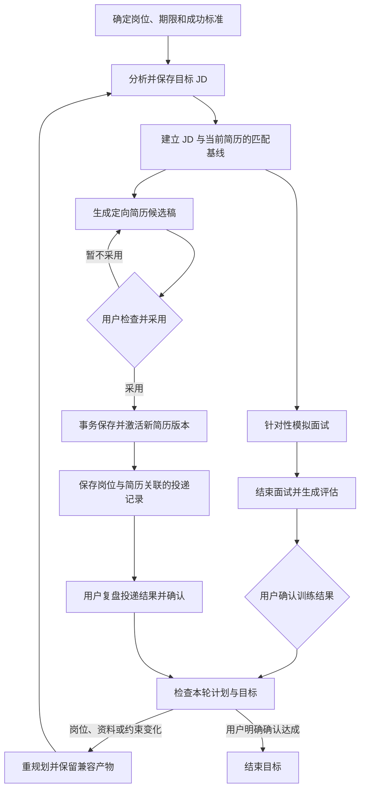
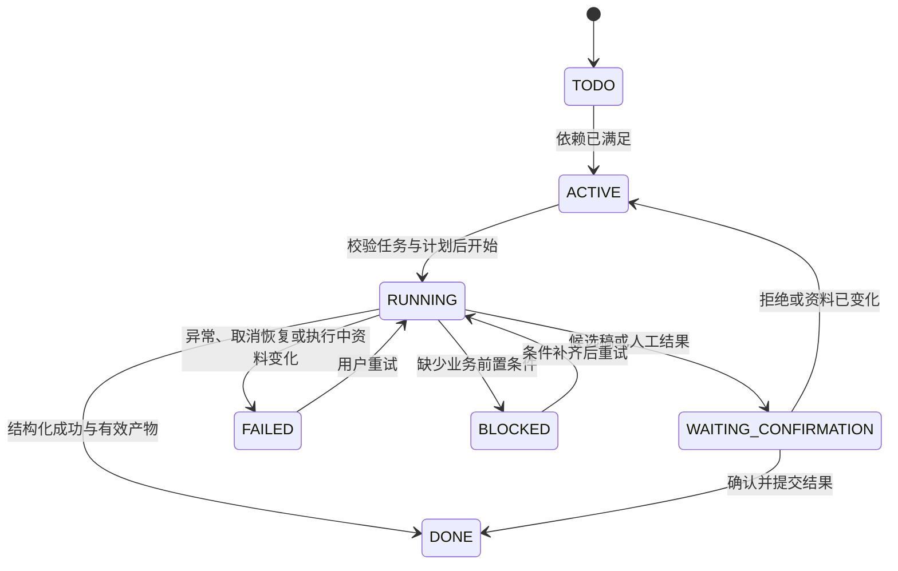
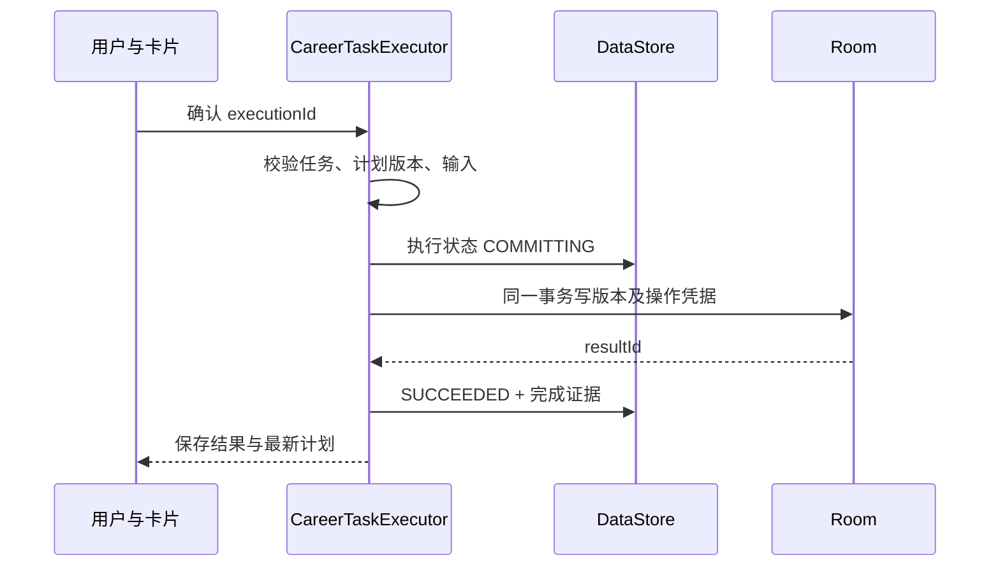

# 求职任务编排

更新日期：2026-11-14。本文描述当前实现，入口位于 `feature/agent`，任务规则位于 `core/domain`，业务持久化位于 `core/data`。

## 业务流程



依赖决定任务能否执行，优先级决定推荐哪一步。简历候选稿等待采用期间，已满足依赖的面试训练可以继续。保存投递记录不会调用外部投递服务，默认状态为“待投”；只有明确的用户投递陈述才记为“已投”。全部任务完成表示本轮计划结束，目标仍需用户确认。

## 完成标准

| 任务 | 有效产物 | 完成方式 |
| --- | --- | --- |
| 岗位样本 | 已保存的目标 JD ID | 工具返回结构化成功及产物 ID |
| 匹配基线 | 匹配报告标识及 JD、简历输入指纹 | 工具返回结构化成功及产物 ID |
| 定向简历 | 经用户采用、已提交的新版本 ID 和内容指纹 | 候选稿 → 用户确认 → Room 保存 |
| 面试训练 | 与目标 JD、简历版本一致的已结束面试及评分 | 用户确认训练结果 |
| 投递记录 | 本地记录 ID | Room 保存成功 |
| 投递复盘 | 与目标 JD 一致的记录及复盘结论 | 用户确认复盘结果 |

展示面试题、读取投递记录、生成建议文本都不能直接完成任务。运行时不再通过结果文本中的“失败”等词判断成功。

## 状态与职责



持久化枚举 `ACTIVE` 保留原名称，表示待执行；实际执行由 `RUNNING` 表示。取消立即回到可执行状态；进程中断后的未完成执行恢复为可重试失败。

| 层 | 切入点 | 职责 |
| --- | --- | --- |
| `core/model` | `CareerAgentState`、`CareerExecution`、`CareerTaskEvidence` | 任务、执行记录、输入身份、候选稿和完成证据 |
| `core/domain` | `CareerTaskReducer` | 纯状态转换；校验依赖、任务 ID、工具、计划版本和证据 |
| `core/domain` | `CareerAgentPlanner`、`CareerAgentSupervisor` | 构建和调整计划；根据真实状态给出下一步建议 |
| `feature/agent` | `CareerTaskExecutor` | 串行执行、确认、拒绝、恢复；连接纯规则与业务仓库 |
| `feature/agent` | `AgentToolCoordinator` | 执行业务工具，返回结构化状态、产物 ID 或候选稿 |
| `feature/agent` | `AgentUseCase` | 按用户意图限制工具；逐轮刷新策略；保留工具历史并输出消息与卡片 |
| `feature/agent` | `AgentViewModel` | 执行卡片动作、展示候选稿、恢复待确认结果 |
| `core/data` | `CareerAgentStateRepository` | 在 DataStore 的串行事务内更新计划；revision 拒绝旧快照覆盖 |
| `core/data` | `ResumeVersionRepository`、`TrackingRepository` | Room 事务提交业务记录和操作凭据 |

模型决定请求哪个工具和怎样表达结果；运行时决定请求能否执行、是否完成，以及是否可采用。

## 确认与防重

1. 执行记录绑定任务 ID、目标 ID、计划版本及 JD/简历输入指纹。输入内容变化或旧计划按钮不能推进新版任务。
2. 工具参数用 JSON 解析后规范化对象键序，忽略无意义的格式差异，保留数组顺序和指令差异。同一轮重复调用被阻止；待确认候选稿可以复用。
3. 采用、拒绝和直接执行任务是应用生成的类型化动作。采用按钮携带执行 ID，不需要再让模型解释“确认”；内部动作不在模型 `render_card` 协议允许的类型中。
4. 采用前重新检查当前资料；保存事务内再次检查源简历版本和内容，避免确认覆盖用户后来选择或修改的简历。
5. Room 操作凭据以执行 ID 为主键。重复采用复用同一版本；重复记录同一公司、岗位、JD 和简历版本复用已有投递记录。用户明确补报已投递时，更新“待投”及时间线；更换简历版本保留独立关联。

## 持久化与恢复

任务计划、执行记录和待确认候选稿保存在 DataStore；简历版本、投递记录及 `agent_operation_receipts` 保存在 Room。数据库由 v14 迁移至 v15，保留既有业务表。



两种存储之间采用可恢复的提交顺序，并非跨库事务。Room 已提交而计划未更新时，保留 `COMMITTING`，下次依据凭据补齐状态。未提交的保存恢复为待确认；未结束的普通执行恢复为可重试失败，不自动重新发起写入。确认开始后，本地事务及状态同步在 `NonCancellable` 中完成，关闭页面不会把提交截断。

执行记录保留全部未结束项和最近 50 条终态项，观察记录最多 50 条，历史计划最多 5 版。

## 重规划规则

- 显式更新目标岗位、期限和成功标准，并归档旧计划、递增版本。
- 更换岗位方向或 JD 后，相关产物失效；不允许旧执行结果推进新任务。
- 只延长期限时，保留输入兼容的完成项。
- 已采用简历仍为当前版本且内容未改时，保留定向简历及生成它的历史匹配基线；用户编辑或切换版本后重新建立基线。
- 没有完成证据的历史任务不会仅凭旧的 `DONE` 状态被保留。失效的前置任务会使依赖项一起失效。
- 旧的待确认动作失效；处于提交中的结果先完成本地同步，再允许更换计划。

## 匹配正确性

JD 技能候选从完整 JD 提取，再与简历比较。移除了按简历内容预先过滤 JD 技能的逻辑，避免 Kotlin、Compose 等缺失技能在比较前被删除。TF-IDF 与可用的本地 Embedding 路径继续沿用现有轻量匹配能力。

## 验证

```powershell
.\gradlew.bat :core:domain:testDebugUnitTest :core:data:testDebugUnitTest :app:testDebugUnitTest
.\gradlew.bat :app:assembleDebug :app:compileDebugAndroidTestKotlin
# 需要设备或模拟器：
.\gradlew.bat :app:connectedDebugAndroidTest
```

JVM 回归覆盖依赖、证据、重复结果、旧计划、资料变化、并行准备、重规划产物保留、进程中断恢复、JSON 防重、DataStore 并发更新及卡片身份序列化。Room 仪器测试覆盖重复采用、事务回滚、源版本变化、投递防重和 v14→v15 数据保留；运行结果以设备验证为准。

2026-11-14 验证：领域层 27 条、数据层 10 条、应用层 17 条 JVM 用例通过，共 54 条；Debug APK 构建通过，仪器测试源码编译通过。当前未连接设备，6 条 Room 仪器用例尚未运行，不据此宣称设备上的事务和迁移验证已完成。

本机 Windows 中文用户路径下，JDK 17 测试启动器需要额外传入 `'-Dorg.gradle.jvmargs=-Xmx2048m -Dfile.encoding=GBK'`，以匹配启动参数文件编码；该参数仅用于命令行验证，未修改工程默认编码设置。

额外尝试了 `:app:lintDebug`；离线环境缺少 lint 32.2.1、IntelliJ/UAST 等检查器依赖，未能执行静态检查，不能将其记为通过。

## 简历表述

可结合实际演示写为：

> 求职业务编排：围绕 JD 分析、匹配、简历采用、面试与投递复盘构建任务状态机；以依赖和产物证据推进任务，支持输入版本校验、用户确认、计划持久化及重规划；通过 Room 事务与操作凭据处理重复提交和中断恢复。

面试建议演示四种场景：候选稿生成但未采用、重复点击采用、换 JD 后点击旧确认、采用简历后仅延长期限。它们分别说明完成标准、幂等提交、版本约束和重规划保留策略。
